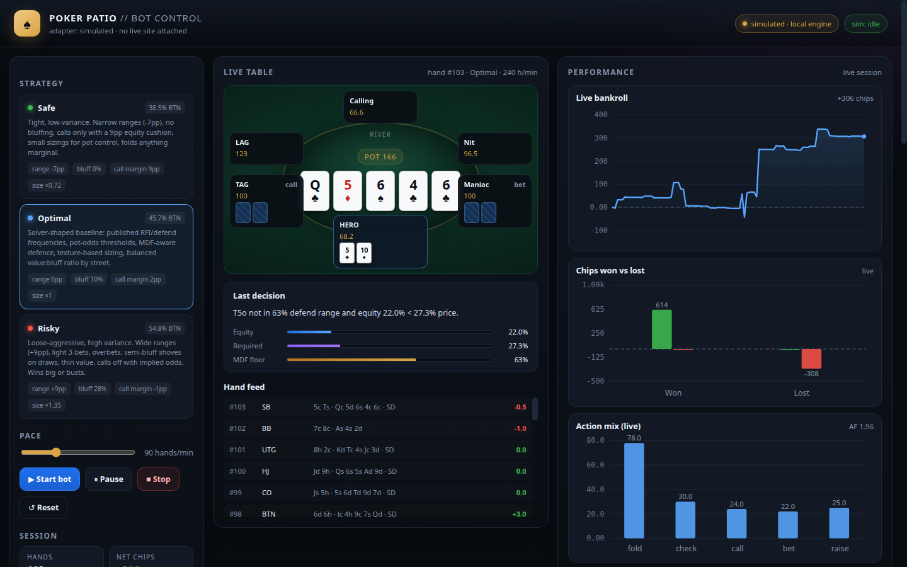
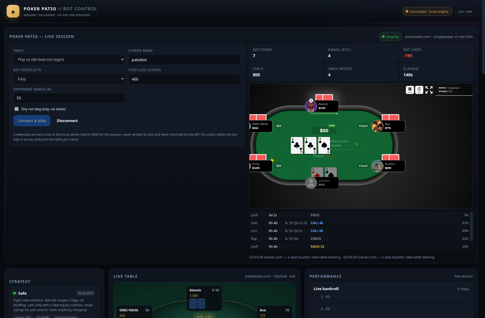

# Poker Patio — Bot Control

A remote control room for a poker bot with **three switchable strategies**
(safe / optimal / risky), live table telemetry, and performance visualisations
built from hands the bot actually plays.

It drives **two backends**:

| Backend | What it is | Needs |
|---|---|---|
| **Live site** | Plays on `https://pokerpatio.com` through a real Chromium: singleplayer vs the site's bots, or public tables after logging in with the form in the control panel | chromium + the credentials you type into the form |
| **Local engine** | The built-in 6-max simulator: full control, instant, no network | nothing |



Open it, pick a strategy, hit **Start bot**, and watch chips move. Then run the
**3-strategy simulation** to compare how each style performs over the same
opponent pool, with confidence intervals so the numbers are not oversold.

---

## Live site bot (pokerpatio.com)



The panel at the top of the dashboard is the control surface:

* **Play vs site bots (no login)** — seats you in the site's singleplayer table
  with the screen name you choose. Nothing to sign up for.
* **Public tables (login required)** — pick a table from the **live lobby
  dropdown** and connect. Joining is a three-step flow on the site, all automated:
  lobby `Join` → the site opens `/pg?game=<room>&auto_seat=true` in a new tab →
  a **SIT** button on the seat map → the buy-in dialog (`Min / Average / Max`)
  → dealt in. The list is scraped from the site's own lobby table, so
  the numbers are the site's: name, players/seats, stakes, average pot, average
  stack, members-only flag. A background browser thread refreshes it every 45 s
  (the ↻ button forces a refresh) and the API serves the cached snapshot, so the
  dropdown opens instantly.

### Login is remembered until you log out

First connect asks for the email + password once. After that:

* the site's **session cookie** is captured and reused, so no password is needed
  at all on the next connect — the bot reopens straight into your account,
* if you tick **"Remember this login until I log out"** (on by default) the
  password is *also* stored, **Fernet-encrypted** at `data/vault.enc` with the
  key at `data/.vault.key`; both files are `chmod 600`. That is what lets the bot
  silently log in again if the cookie expires,
* **Log out** clears the vault (deleting both the ciphertext *and* the key) and
  ends the site session with `GET /logout`. Nothing is left behind.

Threat model, stated plainly: the key sits on the same disk as the ciphertext, so
this protects against casual file reads, backups and shoulder-surfing — not
against someone who already has your shell. That is the inherent ceiling of
"remember my password on this machine"; leave the box unticked if you would
rather only persist the cookie.

Password field is cleared in the browser the moment the request returns, and no
endpoint ever returns the secret (`/api/live/state` and `/api/live/credentials`
carry at most `de****@example.com`).

Every action is a real pointer click on the site's own controls (`fold`, `call`,
`open_raise` → amount → `raise`), and decisions are made by the same three
strategies as the simulator, fed by live DOM state: board, hole cards, pot,
per-seat bets, dealer button and action clock.

Safety rails you can set per session: **dry run** (log decisions, click nothing),
**stop loss** in chips, `max_hands`, and an opponent-range assumption used for
equity. The engine reads only `data-face-up="true"` cards — opponents' hidden
cards are never used, even though the site renders their classes.

### What to expect on the live table

The site's seats act on their own timers (~3–10 s), so a real session runs at
roughly **2–5 hands per minute** — a world away from the simulator's 20 hands/s.
When any seat busts, the singleplayer game ends, shows `Game Lost!`, and deals a
fresh table; the runner counts that as a *table reset*, not as your loss.

Automating a poker site is almost certainly against its terms of service even
when the chips are virtual. You are driving your own account with your own
credits — decide for yourself whether you want that account flagged.

### Why "table did not seat us" happened

Join is not one click. The lobby's `Join` only opens the game page in a **new
tab**; seating happens there, and only after three further steps:

| step | what the site does | what the runner does |
|---|---|---|
| 1 | `Join` → `window.open("/pg?game=<room>&auto_seat=true")` | adopts the popup page (or navigates to that URL directly) |
| 2 | game page renders a seat map with `SIT` buttons (`request_seat_join`) | clicks the first visible `SIT` |
| 3 | `chips_buy_in` popup: `Min / Avg / Max / 100BB` + `Join Table` | sets the amount (`buyin` param, default avg) and clicks `buy_in` |
| 4 | `.player.is-this-player` appears | starts observing and playing |

The old code clicked Join and waited on the **lobby** tab, which never gets a
`.is-this-player` — hence `could not join table: table did not seat us`.

### Selector contract

Everything is pinned in `bot/site.py` (discovered from the live DOM, not
guessed): `.player.is-this-player.active-turn` for the turn, `.actions[data-min-bet]`
for the bar, `.pot-total span` (collected) plus per-seat `.stage-bets` for the
pot, `.player .hand .card` with `val-<rank>` + suit class for cards, and
`tr.lobby-table[data-room-id]` with `.table-name / .table-players / .table-stakes
/ .table-avg-pot / .table-avg-stack` for the lobby dropdown. Joining uses
`[data-action-type="attempt_open_table"][data-type="<room-id>"]`. If the site
re-skins, re-run `python3 tools/discover_actions.py` to re-check.

---

## Quick start

```bash
cd pokerpatio
./run.sh                  # http://127.0.0.1:8777   (uses .venv if present)
# or:  PORT=9000 ./run.sh
```

`run.sh` picks `.venv/bin/python` when it exists — that venv is what carries
`playwright` for the live site. Recreate it with:

```bash
/usr/bin/python3.12 -m venv .venv
.venv/bin/pip install -r requirements.txt
```

Playwright drives the **system chromium** (`/usr/bin/chromium`); no browser
download is needed. Chromium refuses to start when `TMPDIR` is a very long path,
so `run.sh` exports `TMPDIR=/tmp`.

The local-engine half only needs `fastapi`, `uvicorn`, `pydantic`. No build step,
no npm, no CDN — the front-end is plain HTML/CSS/JS with a hand-written SVG
chart library.

First run: `python3 tools/build_preflop.py` regenerates the 169-class preflop
equity table in `data/` (already generated and committed here; ~30s).

---

## What you get

| Panel | What it does |
|---|---|
| **Strategy** | Three cards: Safe, Optimal, Risky. Click to hot-swap the bot's brain mid-session (it resets the table and keeps running). |
| **Pace** | 6–300 hands/minute, live-adjustable. |
| **Session** | Hands, net chips, bb/100, win rate, showdown win %, rebuys. |
| **Live table** | Six seats, stacks, positions, board, pot, hero hole cards, last action per seat. |
| **Last decision** | The reasoning string the engine generated: equity vs required equity, MDF floor, street, tags (`value`, `semi-bluff`, `pot-odds`, `bluff-raise`…). |
| **Hand feed** | Last 30 hands with position, cards, board, showdown flag and chip delta. |
| **Performance** | Live bankroll curve, chips won vs lost, action mix, aggression factor. |
| **Strategy comparison** | Batch sim: bankroll curves for all three, won/lost/net, rate stats, max drawdown, action mix, profit by position, and a full summary table with `bb/100 ± 95% CI`. |
| **Opening range** | 13×13 range grid per strategy / seat / open-vs-defend, with width %. |
| **Why the strategies differ** | Parameter table + the formulas the engine uses. |
| **Live session** | The pokerpatio.com control panel: mode, credentials, stop loss, opponent range, dry run, live KPIs, a screenshot of the real table and a decision feed. |
| **Adapter** | Status of the site adapter and a one-click copy of the DOM probe script. |

---

## Architecture

```
pokerpatio/
├── core/                  # pure poker logic, no I/O
│   ├── cards.py           # int cards, parsing, 169-class labels
│   ├── evaluator.py       # 7-card evaluator, ~165k evals/sec pure python
│   ├── equity.py          # MC equity, range-aware equity, texture, draws
│   ├── ranges.py          # RFI / 3-bet / defend / shove ranges, widening
│   ├── mathx.py           # pot odds, alpha, MDF, SPR, EV, sizing
│   └── strategies.py      # Safe / Optimal / Risky policies + Spot/Decision
├── game/
│   ├── table.py           # betting engine: blinds, min-raises, all-ins, side pots
│   ├── opponents.py       # 5 archetypes with real tendencies
│   └── simulator.py       # batch sessions -> chart-ready metrics
├── bot/
│   ├── runner.py          # local-engine bot: threaded, controllable, emits state
│   ├── lobby.py           # background lobby scout (own browser thread, 45s cache)
│   ├── credentials.py     # encrypted vault: session cookie + optional password
│   ├── site.py            # pokerpatio.com DOM driver (login, table, observe, act)
│   ├── live_runner.py     # live site session: strategy -> real clicks, bookkeeping
│   ├── dom_runner.py      # standalone Playwright runner (legacy/optional)
│   └── adapter.py         # simulated adapter + selector config + probe script
├── server/app.py          # FastAPI: REST + SSE
├── web/                   # index.html, styles.css, app.js, charts.js
├── tools/build_preflop.py # rebuilds data/preflop_equity.json
├── tools/discover_*.py    # DOM discovery passes used to pin the live selectors
├── tests/test_engine.py   # chip conservation, side pots, policy invariants
├── docs/dashboard.png    # screenshot
├── data/preflop_equity.json
├── STRATEGY.md            # the research → spec document
└── run.sh
```

Data flow: `core.strategies.decide(Spot) → Decision` is the single decision
interface. `game.table.Table` builds a `Spot` for every action, applies the
returned `Decision` under real betting rules, and records the action with its
full reasoning payload. `bot.runner` plays hands continuously and publishes
state; the server exposes it over REST and SSE; the browser renders it.

---

## API

| Method | Path | Purpose |
|---|---|---|
| GET | `/api/meta` | strategies, parameters, archetypes, formulas, adapter status |
| GET | `/api/rangegrid?strategy=&seat=&kind=` | 13×13 range grid + width |
| POST | `/api/sim/start` | `{hands, seed, iters}` → runs all three strategies in parallel processes |
| GET | `/api/sim/status` | progress + results |
| GET/POST | `/api/bot/state` · `/start` · `/stop` · `/pause` · `/resume` · `/strategy` · `/rate` | bot control |
| GET | `/api/stream` | SSE: bot state + sim status |
| GET/POST | `/api/adapter` | read/write adapter config, get the DOM probe script |
| POST | `/api/live/connect` | `{mode, email, password, username, room_id, table, remember, strategy, dry_run, stop_loss, opp_pct}` → start a real-site session (password optional when a login is stored) |
| POST | `/api/live/disconnect` · `/pause` · `/resume` · `/strategy` | live session control |
| GET | `/api/live/state` | live status (never contains credentials) |
| GET | `/api/live/screenshot` | fresh PNG frame of the real table |
| GET | `/api/live/lobbies?refresh=1` | the site's lobby rows (name, players, stakes, avg pot, avg stack, room id), cached 45 s |
| GET | `/api/live/credentials` | what is stored: masked email, has session, has password, age — never the secret |
| POST | `/api/live/logout` | end the site session and delete the stored login |
| POST | `/api/live/forget` | delete the stored login without touching the running session |
| GET | `/health` | liveness |

Example — run 1,000 hands per strategy from the shell:

```bash
curl -s -X POST localhost:8777/api/sim/start \
     -H 'content-type: application/json' \
     -d '{"hands":1000,"iters":60,"seed":7}'
curl -s localhost:8777/api/sim/status | python3 -m json.tool | head -40
```

---

## Site adapter — the honest part (legacy .net target)

`https://pokerpatio.net` currently resolves to a **GoDaddy parking lander**
(`HTTP 200 → /lander`, GoDaddy `parking-lander` assets, title `🐴`). There is no
poker client there to observe or act on, so the shipped adapter is
`SimulatedAdapter`: it drives this project's own table engine at full fidelity.

The real-site path is implemented as `DomSiteAdapter` (`bot/adapter.py`) and is
ready for selectors:

1. Open the site in a browser, run the probe script (dashboard → *Copy DOM probe
   script*) in the console. It prints candidate selectors for cards, pot, stack
   and buttons.
2. Paste them into the adapter config and set `"mode": "dom"`:

```bash
curl -s -X POST localhost:8777/api/adapter -H 'content-type: application/json' -d '{
  "mode": "dom",
  "url": "https://your-table-host/table/123",
  "selectors": {
    "table_root": "#table",
    "hero_cards": ".seat.hero .card",
    "board_cards": ".board .card",
    "pot": ".pot-amount",
    "to_call": ".call-amount",
    "stack": ".hero-stack",
    "seat": ".seat",
    "action_button": ".actions button",
    "raise_input": ".raise-slider",
    "confirm_button": ".confirm"
  },
  "timing": {"poll_ms": 400, "action_delay_ms": 900},
  "safety": {"dry_run": true}
}'
```

3. `POST /api/adapter/test` reports what is missing. With Playwright installed
   and a browser tab attached, a DOM runner can drive the same three strategies
   without changing a line of strategy code — the adapter only has to produce a
   `Spot` and consume a `Decision`.

Safety defaults: `dry_run: true` (log decisions, click nothing), `max_buyin`,
`stop_loss`. Nothing on this machine can place a real bet; there is no payment
integration anywhere in the project.

**If you meant a different site** (a real poker room), point the adapter at it —
but check its terms first: automated play is against the rules of essentially
every real-money site, and accounts get seized for it. The engine here does not
care either way; that decision is yours.

---

## Tests

```bash
python3 -m core._selftest        # evaluator ordering, kickers, 165k evals/sec
python3 -m tests.test_engine     # chip conservation, side pots, policy invariants
```

---

## Performance notes

- Evaluator: ~165,000 seven-card evaluations/second in pure Python.
- Preflop equity: table lookup (no MC) for the 169 classes.
- Batch simulation: ~20 hands/second/strategy with 45 MC iterations, run across
  three processes in parallel.
- Live bot: ~1–5 hands/second depending on pace and iteration count; a 6-max
  hand with 220-iteration equity is ~50–120 ms.

Raising `iters` improves decision quality linearly in cost: 45 (fast, noisy) →
120 (good) → 220 (live default) → 400 (analysis).
